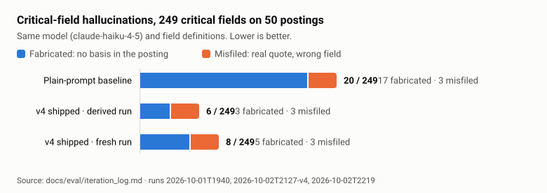
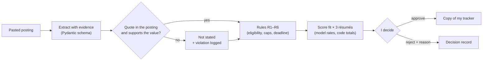
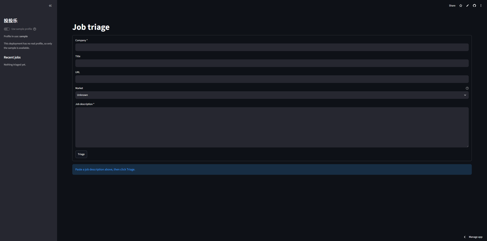

# 投投乐 (TouTouLe)

[](https://github.com/animenzzz128/toutoule/actions/workflows/ci.yml)
[](https://github.com/animenzzz128/toutoule/releases)
[](https://toutoule-uz7gtw3pxwffgea8l8mgwq.streamlit.app/)

**Paste a job posting and get a decision record you can check: every critical field quotes
the posting, code verifies the quote, tested rules decide eligibility, and the error rate is
published.**

> 投投乐是我为自己求职做的 AI 岗位筛选工具。粘贴 JD 后，模型抽取截止日期、签证担保、届别、投递
> 次数限制等关键字段，每个字段都附原文引用，并由代码核验；资格由确定性规则判断，最后由我本人
> 批准。在 50 个真实 JD 上，凭空编造的关键字段从 17 个降到 3–5 个。

<picture>
  <source media="(prefers-color-scheme: dark)" srcset="docs/img/hallucination-dark.svg">
  
</picture>

Not zero: 6–8 of 249 critical fields are still wrong, and the match score does not agree with
my own ratings. Both are explained below, in [Results](#results) and
[What this does not claim](#what-this-does-not-claim).

**Five minutes?** Read in this order:
1. [Why this exists at all](docs/01_PRD.md#1a-why-not-just-a-scheduled-assistant-task): the
   scheduled-prompt baseline it has to beat (D-004)
2. [Why the eval is tiered](docs/05_EVAL_SPEC.md#1-why-tiered-evaluation): errors cost
   different amounts
3. [Iteration log](docs/eval/iteration_log.md): four versions, each with a hypothesis written
   before the run
4. [Scoring write-up](docs/eval/scoring.md): a missed target traced to a specification error,
   not a tuning error

## What it is

An LLM-powered triage tool for one job seeker: me. I'm a business student applying to AI
Product Manager roles in China and the US. For every posting, the same few questions decide
whether it's worth one of my applications: am I eligible, is there a cap on applications,
when does it close, what must I submit, and which résumé should I use. TouTouLe reads a
pasted job description and pulls out those fields, each with a quote from the posting that
code checks against the source. Deterministic rules then flag hard ineligibility, and the
posting is scored against my three résumé versions. A job only goes into my tracker once
I've approved it. Nothing is ever submitted for me.

> a scheduled prompt gives you a summary you have to trust; 投投乐 gives you a decision
> record you can verify, with a measured error rate on the fields where an error costs an
> opportunity.

— [PRD §1a](docs/01_PRD.md)

## Results

The same 50 real job descriptions were run through a plain-prompt baseline (same model,
same field definitions, no schema, no evidence, no verification) and through the pipeline.

| Metric | Target | Plain-prompt baseline | v1 | v4 shipped (derived / fresh) | Met? |
|---|---|---|---|---|---|
| Critical hallucination | 0 / 249 | 20 / 249 (8.0%) | 14 / 249 (5.6%) | 6 / 249 (2.4%) · 8 / 249 (3.2%) | No |
| Critical false negative | ≤ 10% of 67 | 5 / 67 (7.5%) | 13 / 67 (19.4%) | 5 / 67 (7.5%) · 6 / 67 (9.0%) | **Yes** |
| Critical accuracy | ≥ 95% of stated fields | 54 / 57 (94.7%) | 47 / 50 (94.0%) | 55 / 62 (88.7%) · 54 / 57 (94.7%) | No |
| Important accuracy | ≥ 90% of stated fields | 61 / 133 (45.9%) | 45 / 136 (33.1%) | 51 / 131 (38.9%) · 43 / 130 (33.1%) | No |
| Reference recall | ≥ 80% of 552 | 353 / 552 (63.9%) | 254 / 552 (46.0%) | 250 / 552 (45.3%) · 256 / 552 (46.4%) | No |
| Match score within ±10 of my score | 14 / 20 (70%) | — | — | 3 / 20 (15%); constant-guess floor 10 / 20 (50%) | No |

Runs: baseline and v1 `2026-10-01T1940`; v4 derived `2026-10-02T2127-v4` (v3's saved
outputs re-verified in code, 0 API calls); v4 fresh `2026-10-02T2219`; match score
`2026-10-03T0132-score`. Extraction uses `claude-haiku-4-5`, scoring `claude-sonnet-5-5`.
Sources: [`docs/eval/iteration_log.md`](docs/eval/iteration_log.md),
[`docs/eval/scoring.md`](docs/eval/scoring.md).

The match score misses because my 20 hand scores measured *priority* (city, company,
interest in AI PM work), not résumé fit, which is what the scorer rates
([`docs/eval/scoring.md`](docs/eval/scoring.md)).

What improved is fabrication: values with no basis in the posting fell from 17 of the
baseline's 20 critical hallucinations to 3 of 6 (derived) and 5 of 8 (fresh) in v4. What
didn't: important accuracy and reference recall are below the baseline in every pipeline
run. Part of that is a scoring artifact, because the labels are in English and a correct
Chinese answer counts as a miss, but it is still a gap.

Iteration stopped early at v4, recorded as an amendment to
[D-009](docs/06_DECISION_LOG.md) before any of its stop conditions fired. Closing M1 with
these targets missed is [D-012](docs/06_DECISION_LOG.md).

## How it works



The model only reads and cites. Code checks every quote, rules decide eligibility, and nothing
reaches the tracker without my approval.

- **Paste** a job description, with company, title and URL, into the Streamlit app.
- **Extract with evidence.** The model fills a fixed Pydantic schema. Every stated field
  carries a verbatim quote, and "Not stated" is a value of its own. The same text pasted
  twice makes no second model call.
- **Verify in code.** Each quote must appear in the posting, after formatting-only
  normalization, and each required-materials item must be named in its own quote. A field
  that fails becomes "Not stated" and is logged. See
  [ADR-003](docs/adr/003-structured-output-with-verification.md).
- **Rules decide eligibility.** Six deterministic rules flag visa, graduation-window,
  degree and deadline problems and application caps. A field that isn't stated never
  excludes a job, and approving past a HARD flag needs explicit confirmation. See
  [ADR-004](docs/adr/004-rules-decide-eligibility.md).
- **Score fit.** The model rates three dimensions for each résumé version, and code
  computes the 0–100 total, checks both quotes of every evidence pair, and recommends a
  version.
- **Decide and export.** Approve the job, or reject it with one of five structured
  reasons. Approved jobs export to a copy of my 18-column tracker. Rewrite suggestions
  after approval are designed but not built
  ([ADR-007](docs/adr/007-post-approval-rewrites.md)).

The stack is deliberately small: Python, Pydantic, SQLAlchemy on SQLite, the Anthropic
SDK and Streamlit. There's no frontend framework, vector database or orchestration
library ([ADR-001](docs/adr/001-stack-minimalism.md)).

## How this compares

Open-source pipelines such as [career-ops](https://github.com/santifer/career-ops) and
commercial tools such as [Jobright](https://jobright.ai) also rate postings against a
résumé, and they cover far more than this does. Of 17 comparable tools surveyed on 2026-10-27,
I found none that publishes an extraction error rate, and most decide eligibility inside the
prompt ([survey](docs/07_ROADMAP_V2.md#2-comparable-work-surveyed-2026-10-27)). TouTouLe's
difference is deliberately narrow: quotes checked in code, eligibility decided by tested rules,
and a measured error rate, including where it misses. Anthropic's
[Citations](https://platform.claude.com/docs/en/build-with-claude/citations) feature is
documented as not combinable with structured outputs. This project takes the other route:
quotes are part of the schema and verified in code
([ADR-003](docs/adr/003-structured-output-with-verification.md)).

It never submits an application, and auto-apply is out of scope by design.

## Screenshots

Taken from the live demo, which runs on the redacted sample profile.



*Paste a posting and pick its market. The deployment ships no real profile, so the
sidebar toggle is disabled and says which profile is in use.*

## Live demo

[toutoule-uz7gtw3pxwffgea8l8mgwq.streamlit.app](https://toutoule-uz7gtw3pxwffgea8l8mgwq.streamlit.app/)

It runs on a redacted sample profile, not my real résumés, and may stop answering once its
monthly API budget is used up.

## What this does not claim

- **Not zero hallucination.** The shipped version still has 6–8 of 249 critical fields
  hallucinated (invented, or a real quote attached to the wrong field).
- **The match score does not agree with my own ratings** (3 / 20). Read it as résumé fit
  only.
- **No held-out set.** Prompts were tuned on the same 50 postings they're scored on, so
  these results may overstate performance on new postings.
- **Labels are model-drafted and owner-reviewed** ([D-008](docs/06_DECISION_LOG.md)). A
  model from another family drafted them. I labeled five cases blind first as a check
  (22 of 25 critical fields agreed; the 3 disagreements were my errors), and every
  critical-field disagreement was checked against the posting before it counted.
- **One candidate, one market, one cycle.** There's no claim of generalization beyond
  campus recruiting, and none about interview or offer rates. 20 of the 50 postings are
  China platform / e-commerce, my primary market.
- **Coverage is incomplete by design.** WeChat-only postings sit outside the compliance
  boundary and are pasted by hand.
- **Not built yet:** daily discovery, the email digest and ranking from reject reasons are
  planned for M2/M3. Rewrite suggestions (Task 1.10) moved after M1.

Full list: [eval spec §7](docs/05_EVAL_SPEC.md).

## Docs

- [Eval spec](docs/05_EVAL_SPEC.md): how each tier is measured, and why
- [Iteration log](docs/eval/iteration_log.md): every version, hypothesis and result
- [Scoring write-up](docs/eval/scoring.md): what the match-score disagreement measured
- [Decision log](docs/06_DECISION_LOG.md), including reversals
- ADRs: [001](docs/adr/001-stack-minimalism.md) ·
  [003](docs/adr/003-structured-output-with-verification.md) ·
  [004](docs/adr/004-rules-decide-eligibility.md) ·
  [007](docs/adr/007-post-approval-rewrites.md)
- [Execution plan](docs/04_EXECUTION_PLAN.md) · [Roadmap v2](docs/07_ROADMAP_V2.md), after M1

## Setup and run

```bash
uv sync                                        # install dependencies
cp .env.example .env                           # then fill in ANTHROPIC_API_KEY
uv run python -m toutoule.cli check-config     # confirm the settings parse
uv run python -m toutoule.cli init-db          # create the tables
uv run streamlit run app/streamlit_app.py
```

Paste a job description, pick the market if you know it, and click **Triage**. The page
extracts the fields with their quotes, runs the red-flag rules, scores the posting against
all three résumé versions, and waits for you to approve or reject it.

The sidebar toggle switches between the real résumés in `data/private/profile` (never
committed) and the redacted samples in `data/profile`. A job scored against one profile is
not shown under the other: the evidence pairs quote the résumé, so the two never mix.

## Test

```bash
uv run pytest
uv run ruff check && uv run ruff format --check
uv run python -m toutoule.cli eval             # the evaluation harness (calls the API)
```

## Export to the tracker

```bash
uv run python -m toutoule.cli export --base path/to/tracker.xlsx [--jobs 3,7] [--sample]
```

Export appends approved jobs to a **copy** of the tracker and never writes to the file it
reads. It's CLI-only in M1. Two columns stay blank by design: Priority Score, because the
match score measures fit and goes to Candidate Fit ([D-010](docs/06_DECISION_LOG.md),
[D-011](docs/06_DECISION_LOG.md)), and Market, because the market is never stored, so
there's nothing to write at export time.
